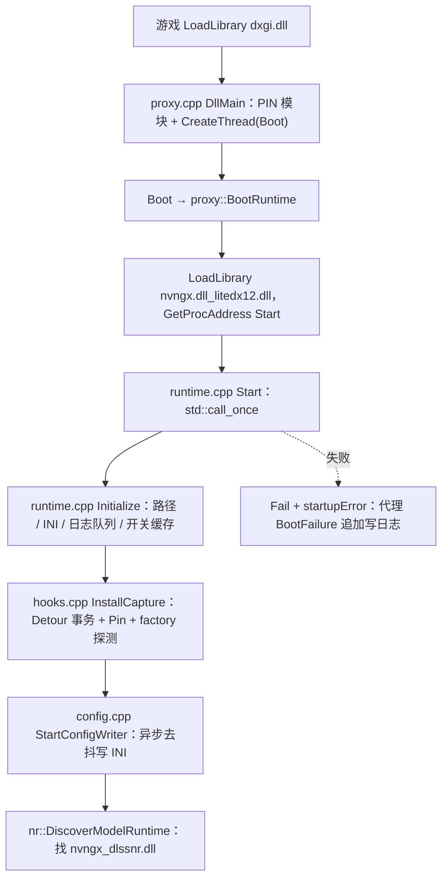
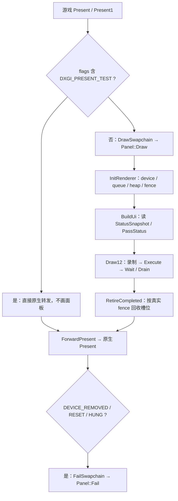
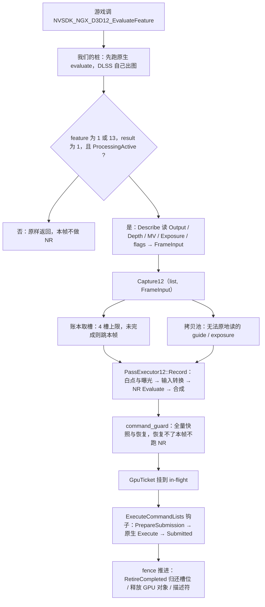

# DLSSNR_LiteDX12 —— 项目流程与重构路线（2026-11-05）

本文是重构前的**现状流程图**与**逐单元重构计划**。架构规则以 [DEVELOPMENT.md](DEVELOPMENT.md) 为准；本文只描述"当前代码实际怎么跑"和"按什么顺序重设计"。

## 0. 现状数字

| 项 | 值 |
| --- | --- |
| `src/` 下 .cpp/.hpp | 7384 行 |
| 产物 | `dxgi.dll`（代理）、`nvngx.dll_litedx12.dll`（主体）、`version.dll` / `winmm.dll`（替代入口） |
| 最大五个文件 | `nr/pass.cpp` 962、`nr/capture12.cpp` 669、`panel_ui.cpp` 501、`input.cpp` 444、`panel.cpp` 431 |
| 测试 | 无。正确性 = 构建零警告 + 行为等价核对 + 用户在游戏里验证 |

分层沿用 DEVELOPMENT.md 的 L0–L5。

图用 Mermaid 绘制：节点标签一律加双引号，标签内不要出现 `->`（解析器会把它当箭头），需要方向感时用 `→`。

## 1. 加载与启动（进程启动，只跑一次）

顺序有意义：`InstallCapture` 必须早于任何重型模型预加载；`StartConfigWriter` 必须在 `Initialize` 之后。

## 2. 接线：谁被钩、钩了做什么

接线是幂等的，随游戏创建对象逐步发生。

| 被钩目标 | 安装时机 | 钩子职责 | 进入的函数 |
| --- | --- | --- | --- |
| `CreateDXGIFactory` / `1` / `2` | `InstallCapture` | 原生创建后，非内部调用才挂主体；代理只做纯转发 | `hooks.cpp` `FactoryExport::CallFrom` → `AttachFactory` |
| `IDXGIFactory` vtable 10/15/16/24 | `AttachFactory`（每个 factory 一次） | **不替换 factory 对象**，只钩 4 个创建入口 | `hooks.cpp` `Create` / `CreateHwnd` / `CreateCore` / `CreateComposition` |
| `LoadLibraryA/W`、`LoadLibraryExA/W` | `InstallCapture` | 加载后探测 d3d11 / d3d12 | `Load::Call` / `LoadEx::Call` → `Watch` |
| `GetProcAddress` | `InstallCapture` | 截获 NGX 四个导出 | `ProcLookup::Call` → `nr::ResolveNgx` |
| `ID3D12CommandQueue::ExecuteCommandLists`(10) | 队列首次出现 | 提交前挂依赖、提交后记账 | `Execute::Call` → `PrepareSubmission` / `Submitted` |
| `ID3D12GraphicsCommandList::Reset`(10) | 列表首次出现 | Reset 成功后让录制失效 | `ResetList::Call` → `Discard` |
| `D3D11On12CreateDevice` | `Watch(d3d11.dll)` 或首次 Present | RTSS 陈旧队列修正 | `On12::CallFrom` |
| `d3d12.dll` 资源创建导出 | `Watch(d3d12.dll)` | 命令列表状态追踪 | `nr::InstallD3D12CommandState` |
| `IDXGISwapChain::Present` / `Present1` / `ResizeBuffers*` | 交换链包装（COM 转发） | 面板绘制 + 原生转发 | `wrappers.hpp` `Swapchain` |

## 3. 每帧 · 渲染线程（Present 链）

## 4. 每帧 · 游戏的渲染线程（NR 链）

## 5. 不可破坏的不变量

| # | 不变量 | 违反的后果 |
| --- | --- | --- |
| R1 | 一帧只有一条路径：observe → capture → guard → pass → 提交 → 退役 | 出现第二条入口，状态无法推理 |
| R2 | 渲染线程不阻塞；唯一允许的是面板关闭 / Resize 的**有界**等待 | 掉帧变成卡死 |
| R3 | 每帧可能失败的初始化必须锁存，且能被用户开关重置 | GTA / RTSS 的教训 |
| R4 | 跨线程共享状态只有 `FrameLedger` | ticket/fence/cookie 再次散落 |
| R5 | 我们的 GPU 对象只在真实 fence 之后释放 | 释放正在使用的资源 |
| R6 | 游戏命令列表状态要么完整恢复，要么这帧不跑 NR | bindless 引擎（MHW）崩溃 |
| 附加 | 代理 `dxgi.dll` 不含任何图形 / UI / 模型逻辑 | 加载顺序与对象所有权失控 |

## 6. 待量化的热点（P0 阶段填数字）

逐模块静态分析结论见 [REFACTOR-ANALYSIS-2026-11-05.md](REFACTOR-ANALYSIS-2026-11-05.md)。

| 路径 | 每帧次数 | 已知成本源 | 状态 |
| --- | --- | --- | --- |
| `Swapchain::Present` → `DrawSwapchain` → `Panel::Draw` | 1 / 帧 | 递归锁、面板全量 UI、fence 查询 | 待测 |
| `ForwardPresent` | 1 / 帧 | `WithParentBypass` 的 `__try/__finally`、`Arguments` 构造、RTSS 探测（已缓存） | 待测 |
| NGX `Evaluate` 桩 | 1 / 帧 | `recursive_mutex` 两次加锁、`std::map` 查找、`Describe` 参数读取 | 待测 |
| `Capture12` | 1 / 帧 | 槽位扫描、拷贝池判定、命令状态快照、ticket | 待测 |
| `Execute` 钩子 | 每个 `ExecuteCommandLists` | 逐 list 与在飞录制比对 | 待测 |
| `Reset` 钩子 | 每次 list Reset | `Discard` | 待测 |

## 7. 逐单元重设计顺序

每个单元一轮：出方案 → 用户确认 → 改 → 构建 → 用户验收。一次只动一个单元。

### A. L0 代理

1. ✅ `proxy.cpp`：`DllMain` → `Attach` → `Boot`；`ResolveDxgi` 纯转发（工厂包装已删，2026-11-05）
2. ✅ `proxy/proxy_common.hpp`：`Attach` / `Boot` / `Resolve` / `LoadOriginal` / `BootFailure` 共用
3. ✅ `proxy/proxy_forward.cpp` + `.def`：`version.dll` / `winmm.dll` 替代入口

### B. L1 启动

文件已合并（2026-11-05，纯搬迁）：`bootstrap.*` → `runtime.*`；`config_storage.*` + `config_writer.*` → `config.*`。

4. `runtime.cpp`：`Start` / `DllMain`
5. `runtime.cpp`：`Initialize` + 日志 / 开关 API
6. `config.cpp`：INI 位置与异步去抖写

### C. L2 接线

7. `hooks.cpp`：`InstallCapture`
8. `hooks.cpp`：`AttachFactory` + 四个 `Create*::Call`
9. `hooks.cpp`：`Watch` / `Load` / `LoadEx` / `ProcLookup` / `InstallOnce`
10. `hooks.cpp`：`WrapSwapchainObject` + `ResolveSwapchainRequest`
11. `wrappers.hpp`：`Swapchain::Present` / `Present1` + `ForwardPresent`（每帧热点）
12. `wrappers.hpp`：`ResizeBuffers` / `ResizeBuffers1` + 其余转发方法（宏/表化，纯减代码）

### D. L3 观察

13. `nr/ngx_observer.cpp`：`ResolveNgx` + `Create` / `Evaluate` / `Release` 桩
14. `nr/ngx_observer.cpp`：`Describe` / `GameResource` / `DescribeExposure`

### E. L4 管线

15. `nr/capture12.cpp`：`Capture12` 主干
16. `nr/command_guard.cpp`：快照 / 恢复
17. `nr/pass.cpp`：`Record` 的输入准备 + 白点 / 曝光
18. `nr/pass.cpp`：模型 Evaluate + 合成 + 计时读回
19. `nr/capture12.cpp`：`PrepareSubmission` / `Submitted` / `Discard` / `RetireCompleted`
20. `nr/model_runtime.cpp` / `model_settings.cpp` / `caller.cpp`

### F. L5 表现

21. `panel.cpp`：构造 / `Draw` / `Close` / Resize 生命周期
22. `panel_gpu.cpp`：`InitRenderer` / `Draw12` / `Wait` / `Drain`
23. `panel_ui.cpp`：`BuildUi` / `BuildResourceUi` / `BuildPipelineStatus`
24. `input.cpp` / `input_keyboard.cpp` / `input_directinput.cpp`：消息路由
25. `preview.cpp` / `white_point.cpp` / `ui_widgets.cpp` / `status.cpp`

## 8. 每轮交付模板

1. **现况**：签名、全部调用点、线程上下文、每帧调用次数、锁/分配/COM 调用、失败模式
2. **问题**：可删 / 可并 / 可内联 / 可缓存 / 可提前判定，每条给依据
3. **目标设计**：新签名、职责边界、不变量、错误处理、线程模型
4. **改动面**：预计行数增减、要改的调用点清单
5. **验证**：`/W4` 零警告 + Release/Debug 构建 + 行为等价核对点 + 需用户在游戏里确认的项
6. **回滚**：改前哈希 / `_backup` 快照

## 9. 红线

- 一次只动一个单元；发现问题只记 backlog，不顺手改
- 外部契约不变：导出名、`Start` 私有 ABI、INI 键、日志格式
- 热路径（Present / Evaluate / Execute / Reset）不新增锁、堆分配、`QueryInterface`、`GetProcAddress`
- 不修改 `DLSSNR_Lite` 与 `_ref/`
- "精简"至少改善一项量化指标：行数、DLL 大小、每帧调用次数；"优化"必须有调用次数依据
